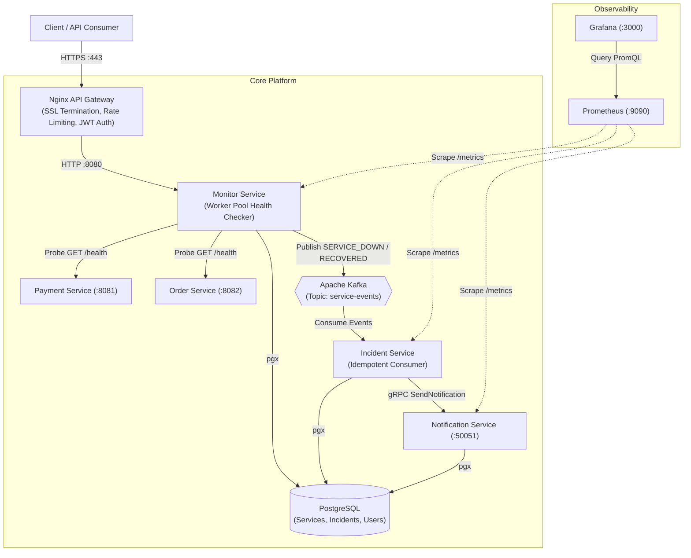

# Distributed Service Monitor & Incident Platform

A resilient, event-driven microservices platform built in Go for automated health monitoring, distributed incident lifecycle management, and alerting.

[](https://golang.org)
[](https://kafka.apache.org/)
[](https://grpc.io/)
[](https://www.postgresql.org/)
[](https://www.docker.com/)
[](https://prometheus.io/)

---

## 1. System Architecture



---

## 2. Microservice Catalog

| Service | Port | Protocol | Responsibility |
| :--- | :--- | :--- | :--- |
| **Nginx Gateway** | `80`, `443` | HTTPS / HTTP | Edge reverse proxy, SSL termination, rate limiting (10 req/s, burst 20), JWT `auth_request` validation |
| **Monitor Service** | `8080` | HTTP / REST | Service registration CRUD, worker pool health checking, JWT issuance, Kafka event production, Prometheus metrics |
| **Incident Service** | `8083` | Kafka / gRPC / HTTP | Consumes Kafka health events, enforces PostgreSQL idempotency, dispatches gRPC alerts with retry/backoff |
| **Notification Service** | `50051`, `8084` | gRPC / HTTP | Receives incident notifications over gRPC, records alerts, logs dispatches |
| **Payment Service** | `8081` | HTTP | Monitored target microservice with `/health` and simulated outage toggle (`/simulate-outage`) |
| **Order Service** | `8082` | HTTP | Monitored target microservice with `/health` and simulated outage toggle |
| **PostgreSQL** | `5432` | TCP (pgx) | Relational persistence for registered services, incidents, notifications, and users |
| **Apache Kafka** | `9092` | TCP (KRaft) | Event bus decoupling health detection from incident reaction |
| **Prometheus** | `9090` | HTTP | Pull-based metrics scraper collecting throughput, latencies, probe results |
| **Grafana** | `3000` | HTTP | Pre-provisioned dashboards for platform health and incident trends |

---

## 3. Key Technical Highlights & Design Decisions

### 1. Bounded Worker Pool Health Checking
- Rather than launching unbounded goroutines that risk socket exhaustion, the Monitor Service uses a bounded worker pool (`HEALTH_WORKER_COUNT=5`).
- Uses fan-out channels, fan-in results, and `sync.WaitGroup` with strict context timeouts to ensure predictable resource utilization during health probe cycles.

### 2. Event-Driven Decoupling with Kafka
- Monitor service does not know or care about incident responders. State transitions (`SERVICE_DOWN`, `SERVICE_RECOVERED`) are emitted to the `service-events` Kafka topic with unique UUID `event_id`s.
- Enables zero-loss event buffering even if downstream incident services are restarting.

### 3. Consumer Idempotency
- Kafka guarantees at-least-once delivery. To prevent duplicate incident creation during consumer restarts or partition rebalances, the Incident Service uses PostgreSQL `UNIQUE (idempotency_key)`.
- Replayed messages trigger `ON CONFLICT DO NOTHING`, discarding duplicates safely.

### 4. gRPC Communication with Exponential Backoff
- The Incident Service communicates with the Notification Service via gRPC over HTTP/2 with compiled Protobuf contracts (`notification.proto`).
- Calls are wrapped in an exponential backoff retry loop with randomized jitter (`pkg/retry`) to handle transient network blips gracefully.

### 5. Edge Security & Rate Limiting at Nginx
- SSL/TLS terminates at Nginx with modern ciphers.
- Per-IP rate limiting (token bucket: 10 req/s, burst 20) rejects abusers with HTTP `429` at the network boundary before Go memory or connection pools are touched.
- JWT verification is delegated via Nginx `auth_request` subrequests to `/api/v1/auth/validate`.

---

## 4. Quick Start

### Prerequisites
- Go 1.25+
- Docker & Docker Compose

### Local Build & Unit Tests
```bash
# Verify build across all packages
go build ./...

# Run unit tests
go test -v ./...
```

### Run with Docker Compose
```bash
# Start all containers in background
docker compose -f deployments/docker-compose.yml up --build -d

# Check running services
docker compose -f deployments/docker-compose.yml ps
```

### Run Interactive Live Demo
```powershell
# On Windows
pwsh -File scripts/demo.ps1

# On Linux / macOS
bash scripts/demo.sh
```

---

## 5. API Reference

### Authentication
- `POST /api/v1/auth/login`
  - Body: `{"username": "admin", "password": "admin123"}`
  - Response: `{"token": "<JWT_TOKEN>"}`

- `GET /api/v1/auth/validate`
  - Headers: `Authorization: Bearer <JWT_TOKEN>`
  - Response: `200 OK` (sets `X-User-ID: admin`) or `401 Unauthorized`

### Services Management (Requires JWT)
- `POST /api/v1/services`
  - Body: `{"name": "payment-service", "endpoint": "http://payment-service:8081/health"}`
  - Response: `{"id": 1}`

- `GET /api/v1/services`
  - Response: Array of registered services with live `status` (`healthy`, `down`, `unknown`)

### Observability Endpoints
- `GET /health`: Liveness probe
- `GET /metrics`: Prometheus exposition format on port `:8080`, `:8083`, `:8084`
- Grafana: `http://localhost:3000` (User: `admin`, Password: `admin`)
- Prometheus: `http://localhost:9090`

---

## 6. Project Layout

```
service-monitor/
├── cmd/
│   ├── monitor/               # Monitor Service entrypoint & Dockerfile
│   ├── incident/              # Incident Service entrypoint & Dockerfile
│   ├── notification/          # Notification Service entrypoint & Dockerfile
│   ├── payment-service/       # Target microservice stub & outage toggle
│   └── order-service/         # Target microservice stub & outage toggle
├── internal/
│   ├── monitor/               # Config, auth, worker pool, handlers, repo, business service
│   ├── incident/              # Kafka consumer, idempotent repo, gRPC client, service
│   └── notification/          # gRPC server handler, repository, service
├── pkg/
│   ├── database/              # Tuned pgxpool factory & schema migrations runner
│   ├── kafka/                 # Kafka producer & consumer group wrappers (kafka-go)
│   ├── model/                 # Shared domain models & event schemas
│   ├── proto/notification/v1/ # Compiled Protobuf & gRPC interfaces
│   ├── metrics/               # Prometheus instrumentation & middleware
│   ├── logging/               # Structured slog setup
│   └── retry/                 # Exponential backoff with jitter
├── proto/
│   └── notification/v1/       # notification.proto definition
├── deployments/
│   ├── docker-compose.yml     # Multi-container orchestration
│   ├── nginx/                 # Gateway reverse proxy, rate limiting & SSL certs
│   ├── prometheus/            # Prometheus scrape config
│   └── grafana/               # Auto-provisioned datasources & dashboard JSON
├── migrations/                # Versioned SQL migration scripts
├── scripts/                   # Demo simulation scripts (PowerShell & Bash)
├── Makefile                   # Build, test, up, down, demo commands
└── README.md
```
